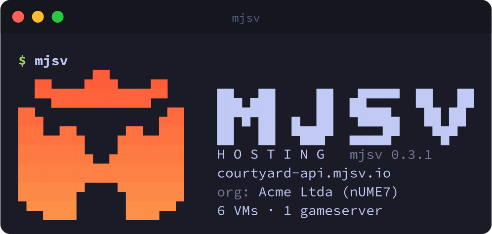
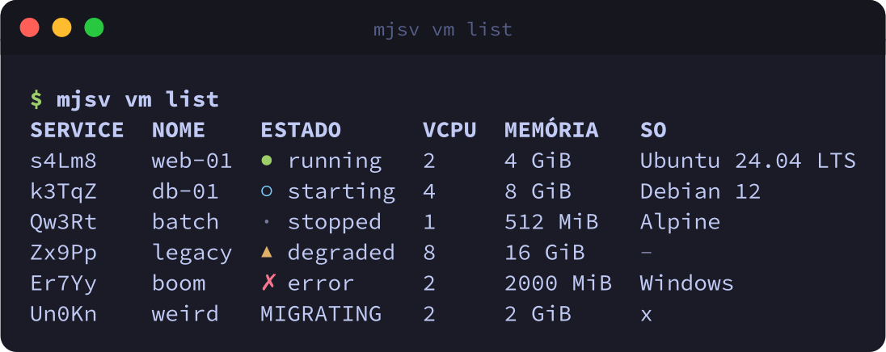
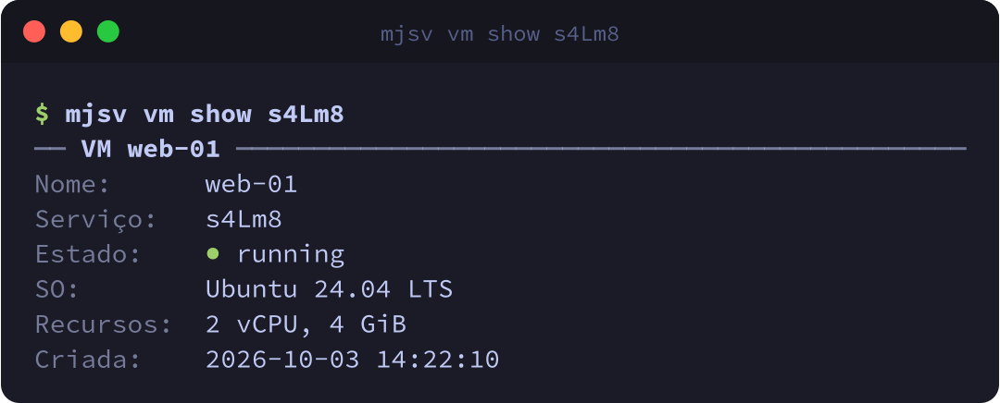
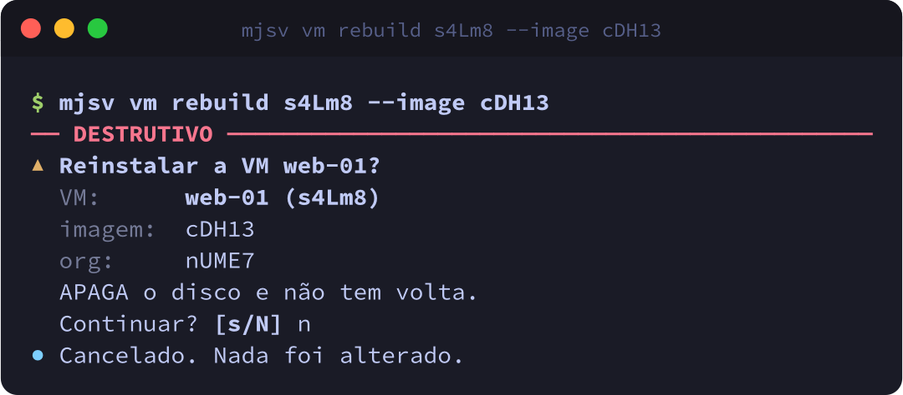
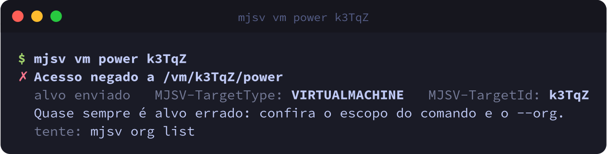
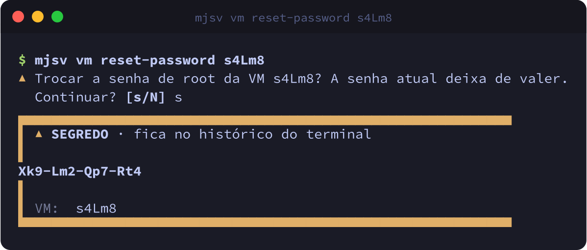

<p align="center">
  
</p>

<h1 align="center">mjsv</h1>

<p align="center">
  O CLI do <a href="https://mjsv.io">MJSV.IO</a>: VMs, gameservers, firewall, pedidos e tickets pela linha de comando.
</p>

<p align="center">
  <a href="https://github.com/majesticsv/mjsv-cli/actions/workflows/ci.yml"></a>
  <a href="https://github.com/majesticsv/mjsv-cli/releases/latest"></a>
  <a href="LICENSE"></a>
</p>

---

O `mjsv` fala com a mesma API que o painel usa (`courtyard-api.mjsv.io`). Tudo o que um membro de
organização faz no painel tem comando aqui — e cada comando serve tanto para gente quanto para script:

- **No terminal**, saída legível: tabelas com estado colorido, cartões de detalhe, erros que dizem o
  comando que resolve, confirmação antes de qualquer coisa destrutiva.
- **Em script**, `--output json` repassa o corpo da API sem tocar num byte, e `--print-request` mostra a
  requisição sem enviá-la.

## Instalação

```sh
curl -fsSL https://raw.githubusercontent.com/majesticsv/mjsv-cli/master/install.sh | sh
```

O script detecta sistema e arquitetura, confere a soma SHA-256 do binário contra o `SHA256SUMS` da
release e instala em `/usr/local/bin` — ou em `~/.local/bin` se o primeiro não for gravável. Ele **não**
chama `sudo` sozinho.

| variável | efeito |
|---|---|
| `MJSV_INSTALL_DIR` | onde instalar |
| `MJSV_VERSION` | fixa a versão (ex.: `v0.3.1`) em vez da mais recente |

Há binários para Linux (x86_64 e aarch64, estáticos com musl), macOS (Intel e Apple Silicon) e
Windows (x86_64) em cada [release](https://github.com/majesticsv/mjsv-cli/releases). Ou compile:

```sh
cargo install --path crates/mjsv
```

## Primeiros passos

```sh
mjsv login              # usuário e senha (e o código 2FA, se a conta usar)
mjsv org list           # as organizações da sua conta
mjsv org use <id>       # fixa a organização corrente
mjsv vm list
```

<p align="center">
  
</p>

> **Ids são de serviço, não do recurso.** A coluna `SERVICE` de `mjsv vm list` e `mjsv gs list` é o que
> todos os outros subcomandos recebem: as rotas da API são `/vm/:vmServiceId` e
> `/gameserver/:gameServerServiceId`. Passar o id da VM dá 403, não 404.

## No terminal

<table>
  <tr>
    <td width="50%" valign="top">
      <b>Detalhe</b><br>
      
    </td>
    <td width="50%" valign="top">
      <b>Confirmação antes do que não tem volta</b><br>
      
    </td>
  </tr>
  <tr>
    <td width="50%" valign="top">
      <b>Erros que dizem o que fazer</b><br>
      
    </td>
    <td width="50%" valign="top">
      <b>Segredos mostrados uma vez</b><br>
      
    </td>
  </tr>
</table>

Os enfeites só aparecem num terminal interativo, decididos fluxo a fluxo: em pipe, redirecionamento ou
`--output json|yaml`, a saída é exatamente a de sempre. Terminais sem Unicode recebem o desenho em
ASCII, e os acentos do português ficam.

## Comandos

Flags globais: `--org`, `--output {table,json,yaml}`, `--api-url`, `--print-request`, `--yes`, `-v`.
Toda ajuda está em `mjsv <comando> --help`.

<details>
<summary><b>Conta e organização</b> — login, perfil, membros, cargos, serviços, notificações</summary>

```sh
mjsv login                                 # usuário/senha, com 2FA quando a conta exigir
mjsv login --token                         # autentica com uma chave de API existente
mjsv whoami [--full]                       # quem está autenticado (--full: saldo, 2FA, cobrança)
mjsv profile show | update [--name ..] [--tax-id ..] [--billing-* ..]
mjsv session list                          # sessões de login da conta

mjsv org list | use <id>
mjsv org create <nome> | show [org] | rename <org> <nome> | delete <org> | leave <org>
mjsv org audit-log [--page N --count N --search S --filter campo[op]=valor]
mjsv org member list | add <email> | remove <user> | role-add <user> --role <id> | role-remove <user> --role <id>
mjsv org role list | flags | create --name N --position P (--flags a,b | --mask M) | update <role> | delete <role> | swap <a> <b>
mjsv org invite list | revoke <convite>
mjsv org service list | show <serviço> | rename <serviço> <nome> | cancel <serviço> (--now | --end-of-period) | cancel-undo <serviço>
mjsv notification list [--type T] [--unread] | count [--by-type] | read <id> | read-all | delete <id> | clear-read

mjsv ssh-key list | add | delete
mjsv token list | create | revoke
```

</details>

<details>
<summary><b>VMs e rede</b> — energia, rebuild, senhas, firewall, VPCs, volumes, proteção anti-DDoS</summary>

```sh
mjsv vm list | show | start | stop | reboot | kill | power | metrics | console
mjsv vm resolve <servico>                  # id do servico -> id da VM
mjsv vm images <servico>                   # imagens para o rebuild
mjsv vm cloud-images                       # catalogo de imagens de nuvem da org
mjsv vm vpcs <servico>                     # VPCs de destino para o move
mjsv vm move <servico> --vpc <vpc>
mjsv vm rebuild <servico> --image <id> [--password]
mjsv vm reset-password <servico> [--password]
mjsv vm root-password <servico> | vnc-token <servico>
mjsv vm sync-dhcp-ip <servico> [--ip IP]
mjsv vm update <servico> --vnc-password
mjsv vm ssh-keys <servico> (--key <id>... | --clear)
mjsv vm incidents <servico> [--status active|ended] [--ip IP] [--from T] [--to T] [--limit N] [--cursor C]
mjsv vm incident <servico> <incidente>
mjsv vm firewall list <vm> | add <vm> … | delete <vm> <regra>
mjsv vm firewall rule-update <servico> <regra> [--action|--protocol|--ports|--source|--description|--position|--enabled]
mjsv vm firewall gameguard-set <servico> --ports 27015[-27020] --profile CS2
mjsv vm firewall gameguard-rm <servico> <faixa>

mjsv eip list <vm>
mjsv vpc list | regions | create --region R --name N | delete <id>
mjsv volume list | available --vm <servico> | products --vm <servico> | attach <vol> --vm <servico> | detach <vol>
mjsv protection show|telemetry|incidents|incident|firewall <servico> ...
mjsv protection gameguard set|rm <servico> <endereco> ...
```

</details>

<details>
<summary><b>Gameservers</b> — energia, arquivos, bancos, agendamentos, add-ons e modpacks</summary>

```sh
mjsv gs list | show | start | stop | restart | kill | reinstall
              | metadata | databases | schedules | sftp
mjsv gs by-service <service>               # gameserver a partir do id do serviço
mjsv gs startup <id> --env CHAVE=VALOR ... # variáveis de ambiente do servidor
mjsv gs file ls <id> [dir]                 # lista um diretório
mjsv gs file cat <id> <path>               # imprime um arquivo de texto
mjsv gs file download <id> <path>          # imprime o link temporário de download
mjsv gs file upload <id> <local> <remote>  # envia um arquivo
mjsv gs file mv|mkdir|compress|decompress|rm ...   # rm pede confirmação
mjsv gs db create|password|delete <id> <nome>      # delete pede confirmação
mjsv gs schedule show|create|edit|delete ...       # agendamentos (--cron de 5 campos)
mjsv gs schedule task add|edit|delete ...          # tarefas do agendamento
mjsv gs addon search|categories|show|versions <game> ...   # catálogo de add-ons
mjsv gs addon resolve|lookup|updates <game> --file corpo.json
mjsv gs addon installed|install|remove|check-updates <id>  # add-ons do servidor
mjsv gs modpack search|show|resolve|lookup <game> ...
mjsv gs setup|fields|options <game> [...]  # configuração do jogo no catálogo
```

</details>

<details>
<summary><b>Pedidos, pagamento e suporte</b> — pedidos, faturas, catálogo, tickets</summary>

```sh
mjsv order list | pending | show | cancel | invoice | delete <id>
mjsv order create --product <id> --option <compId>=<valor> [--currency BRL] [--service <id>] [--coupon C] [--wallet <centavos>]
mjsv order create --file corpo.json        # (ou `-` para stdin; vários itens)
mjsv order quote ...                       # simula preço/cupom/troca de plano sem criar nada
mjsv order group <id> <id> ...             # agrupa pedidos pendentes
mjsv order pay <id> [--method MercadoPago|Balance] [--use-balance]   # imprime a URL de pagamento
mjsv order coupon <codigo>                 # consulta cupom
mjsv order metadata                        # campos de filtro de pedidos
mjsv order generate-pdf <id> [--out-file fatura.pdf]   # mesma fatura de `invoice`, via POST
mjsv payment methods                       # formas de pagamento
mjsv product list [--search S] [--filter campo=valor] | get <id> | isos <id> [--region <id>|--region-option <id>] | metadata

mjsv ticket list [--category <id numérico>|--service <id>] | categories | show | messages | open | reply | close
mjsv ticket message <id-da-mensagem> | reopen <id>
```

</details>

Completions do shell: `mjsv completions bash > /etc/bash_completion.d/mjsv` (também `zsh`, `fish`,
`powershell` e `elvish`).

## Em scripts

### Autenticação sem arquivo

```sh
export MJSV_TOKEN="$(mjsv token create ci --output json | jq -r .token)"
```

`MJSV_TOKEN` vence qualquer arquivo, então o CI nunca precisa escrever credencial em disco. O segredo
só é exibido na criação — `mjsv token list` não o devolve.

Logar pelo CLI **não derruba a sessão do navegador**: o `serviceId` usado aqui é `mjsv-cli`, e o
backend só descarta sessões do mesmo `serviceId`.

### Saída para máquina

`--output json` repassa o corpo da API sem reordenar nem reinterpretar — é o contrato de script.
`--output yaml` é a mesma coisa, legível. Nenhum dos dois recebe arte ou cor, mesmo num terminal.

Em saída de máquina os comandos destrutivos **exigem `--yes`**: não há como perguntar, e um script
que apaga recurso sem ninguém confirmar é pior do que um que falha. Os prompts saem no **stderr**,
então `mjsv ... > arquivo` nunca os engole.

### `--print-request`

Mostra a requisição que seria enviada — método, URL, cabeçalhos de alvo e corpo — sem enviá-la. O
bearer nunca é impresso.

```console
$ mjsv vm firewall add nUME7 --action drop --protocol tcp --ports 65000 --print-request
POST https://courtyard-api.mjsv.io/vm/nUME7/firewall/rules
Authorization: Bearer <omitido>
MJSV-TargetId: nUME7
MJSV-TargetType: VIRTUALMACHINE

{
  "action": "drop",
  "portEnd": 65000,
  "portStart": 65000,
  "protocol": "tcp"
}
```

É a forma barata de revisar o par de cabeçalhos, que é a causa quase certa de qualquer 403 da API.

## Configuração

| variável | efeito |
|---|---|
| `MJSV_TOKEN` | credencial (chave de API ou sessão); vence o `credentials.toml` |
| `MJSV_ORG` | organização corrente; vence o `mjsv org use` |
| `MJSV_API_URL` | outra API (ex.: um ambiente local) |
| `NO_COLOR` | sem cor — a arte continua |
| `MJSV_NO_BANNER` | sem banners e ilustrações — glifos e cartões continuam |
| `MJSV_ASCII` | força o desenho ASCII mesmo num terminal Unicode |
| `TERM=dumb` | texto simples, sem nada |

| arquivo | conteúdo |
|---|---|
| `~/.config/mjsv/config.toml` | org corrente, URL da API, formato preferido |
| `~/.config/mjsv/credentials.toml` | o token — criado com modo `0600` |

São dois arquivos de propósito: o primeiro é inofensivo e pode ser copiado entre máquinas, o segundo
guarda um JWT de 365 dias.

## Desenvolvimento

| crate | o que é |
|---|---|
| `mjsv-core` | cliente da API: HTTP, cabeçalhos de alvo, login, configuração e o sistema visual do terminal |
| `mjsv` | o binário |

```sh
cargo test
cargo clippy --all-targets -- -D warnings
cargo fmt --all --check
./scripts/refresh-routes.sh   # reextrai o inventário de rotas do /doc-json
```

`crates/mjsv-core/tests/api-routes.txt` é o inventário de rotas de cliente do backend, vendorizado para
o CI não depender da rede. `tests/contract.rs` confere que toda rota chamada pelo CLI ainda existe —
uma renomeação no backend vira teste vermelho aqui em vez de 404 na máquina de um cliente.

Uma rota que ainda depende de deploy do backend entra em `routes.rs` marcada com `pending`, e um
segundo teste **falha assim que ela chega à produção**, cobrando a remoção da marca.

As imagens deste README são saídas reais do `mjsv` contra uma API de teste com dados fictícios.

### Release

Empurrar uma tag `v*` dispara o workflow de release: musl (x86_64/aarch64), macOS (x86_64/aarch64),
Windows (x86_64), mais `SHA256SUMS`. Máquinas internas recebem por RPM (`cicd/rpm/mjsv-cli.spec`).

## Licença

[MIT](LICENSE)
